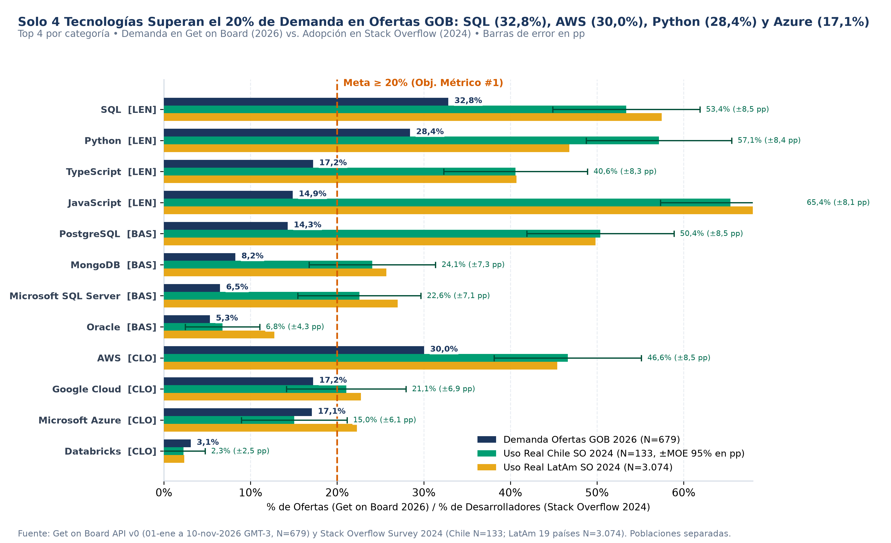
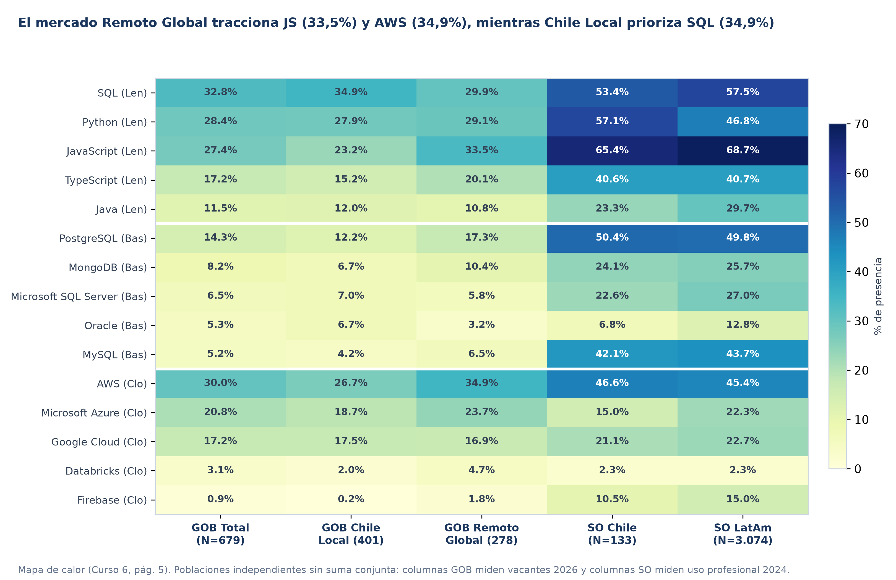
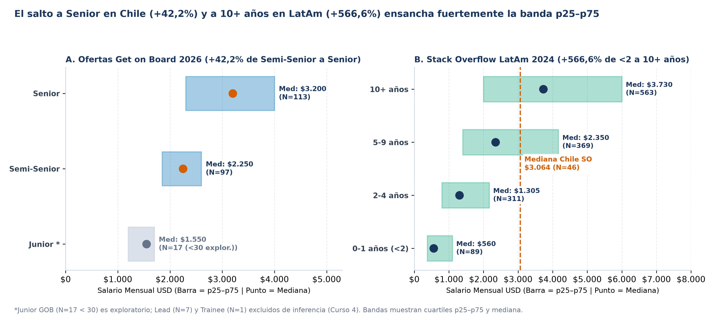

# Portafolio Google Data Analytics — Caso Práctico 3 (Pista B)

🌐 **Sitio Web Oficial en Vivo (GitHub Pages):** [https://jmryanez.github.io/mercado-tech-chile-latam-2026/](https://jmryanez.github.io/mercado-tech-chile-latam-2026/)  
📁 **Repositorio en GitHub:** [https://github.com/jmryanez/mercado-tech-chile-latam-2026](https://github.com/jmryanez/mercado-tech-chile-latam-2026)  
👤 **Autor:** Manuel Yáñez Orellana • **Patrocinador simulado:** Consultora RRHH Tech & Academia Digital (Chile)  
🎓 **Metodología:** 6 fases oficiales del **Certificado Profesional de Análisis de Datos de Google** (*Preguntar, Preparar, Procesar, Analizar, Compartir y Actuar*) — Cursos 1 a 9.

---

## Síntesis Ejecutiva

Este proyecto investiga con trazabilidad reproducible qué tecnologías concentran la demanda laboral vigente aplicable a Chile (**Get on Board API v0**, corte `2026-11-10 GMT-3`, `N = 679` ofertas / `N = 235` salarios válidos) frente a la adopción profesional real en Chile y Latinoamérica (**Stack Overflow Survey 2024**, `19` países, `N = 3.074` / `1.341` salarios válidos; Chile `N = 133` / `46` salarios), contextualizadas contra la serie internacional **Data Science Salaries 2020–2024** (`N = 6.599`, `CC0 1.0`) y la línea base nacional chilena **INE ESI 2025** (`$680.000 CLP` netos/mes = `$701,18 USD` al Dólar Observado BCCh de `$969,80 CLP/USD` al `2026-11-10`).

Las cuatro poblaciones se analizan **de forma estrictamente separada** (sin promediar ni sumar registros entre encuestas y bolsas de empleo) y bajo control muestral **`N >= 30`** (**Curso 4, Módulo 1**).

---

## Glosario Metodológico: Qué es `N`, Regla `N >= 30` y sus Derivadas (Curso 4, Módulo 1)

Conforme a la lectura oficial *Calcular el tamaño de la muestra* (**Curso 4, Módulo 1**):

- **`N`**: Conteo exacto de observaciones independientes válidas (ofertas únicas, encuestados o salarios válidos) dentro de un universo o segmento.
- **Por qué `N >= 30`**: Según el **Teorema del Límite Central (CLT)**, `30` es el tamaño mínimo de muestra a partir del cual los resultados comienzan a representar de manera estable a la población bajo un **nivel de confianza del 95%**, reduciendo el margen de error y el riesgo de hallazgos por azar (**significación estadística**).
- **Derivadas utilizadas en el proyecto**:
  1. **`N` universo total vs. `N` salarios válidos**: Separación de denominadores (`679` ofertas vs. `235` salarios válidos en Get on Board; `3.074` vs. `1.341` en Stack Overflow LatAm; `133` vs. `46` en Chile).
  2. **`N >= 30` (`cumple_n30 = True`)**: Subgrupos habilitados para inferencias descriptivas, bandas `p25–p75` y recomendaciones operativas.
  3. **`N < 30` (`exploratorio` / `cumple_n30 = False`)**: Submuestras reportadas por transparencia sin fijar reglas automáticas (`GOB Junior N=17`, `Lead N=7`, `Trainee N=1`, `ML & AI N=21`, `SysAdmin/DevOps/QA N=24`, `Product N=20`, `12` países de LatAm y subceldas año×tamaño DSS `Med 2020 N=17`, `Peq 2020 N=24`, `Gr 2024 N=12`).
  4. **`N = 0`**: Ausencia total de registros válidos en esa intersección (`Empresas Pequeñas 2024` en DSS).
  5. **Cotas observadas (`N >= 38`, `N >= 335`, `N >= 34`, `N >= 60`, `N >= 75`)**: Indican el `N` real más bajo presente dentro de una gráfica o tabla específica después de filtrar por `N >= 30`.

---

## Las 4 Preguntas de Investigación Estratégicas y sus Respuestas Empíricas

El estudio responde de forma sistemática a las **4 Preguntas Estratégicas del SOW (Fase 1: Ask)**, complementadas con una profundización analítica salarial:

### 📌 Pregunta de Investigación 1 (P1): Demanda vs. Adopción Real
* **❓ Pregunta de Negocio:** *¿Cuáles son las tecnologías más demandadas por los empleadores tech en Chile y qué brechas existen frente a las habilidades que realmente dominan los profesionales?*
* **💡 Respuesta Basada en Datos:** Solo 5 tecnologías superan el umbral del 20% en Get on Board (SQL 32,84%, AWS 30,04%, Python 28,42%, JavaScript 27,39% y Microsoft Azure 20,77%). Existe un déficit crítico en Cloud: Microsoft Azure presenta una brecha de demanda no cubierta (+5,73% más solicitada en ofertas que dominada por desarrolladores en Chile).



---

### 📌 Profundización Cuantitativa Q11 (Derivada de P1): Retorno Salarial Cloud
* **❓ Pregunta de Negocio:** *¿Aprender la tecnología con mayor volumen de ofertas (SQL) asegura los mejores ingresos, o las plataformas Cloud pagan primas salariales superiores?*
* **💡 Respuesta Basada en Datos:** SQL concentra el mayor volumen pero marca el piso salarial base ($2.250 USD mediana). La verdadera prima de compensación la aportan las tecnologías Cloud (AWS $2.850 USD, GCP $2.825 USD y Azure $2.775 USD), que elevan la remuneración entre un +23,3% y +31,5% sobre SQL (+$525 a +$600 USD mensuales adicionales).




---

### 📌 Pregunta de Investigación 2 (P2): Experiencia y Progresión Salarial
* **❓ Pregunta de Negocio:** *¿Cómo impactan los años de experiencia en la compensación mensual y cuál es la magnitud real del salto salarial al alcanzar el nivel Senior en Chile?*
* **💡 Respuesta Basada en Datos:** El paso de Semi-Senior ($2.250 USD) a Senior ($3.200 USD) representa un salto salarial neto de +42,2% (+$950 USD mensuales netos adicionales). Ambos segmentos cumplen rigurosamente N ≥ 30, definiendo bandas cuartílicas sólidas: Semi-Sr ($1.850–$2.600 USD) y Senior ($2.300–$4.000 USD). En LatAm, la compensación crece un +566,6% acumulado a lo largo de 10+ años de trayectoria.



---

### 📌 Pregunta de Investigación 3 (P3): Modalidad y Correlación vs. Causalidad (Q12)
* **❓ Pregunta de Negocio:** *¿El trabajo remoto ofrece salarios más altos por sí mismo, o existe un sesgo de composición de cargos que explica la diferencia salarial?*
* **💡 Respuesta Basada en Datos:** Correlación no implica causalidad (Curso 6). Aunque el 'Remoto Local' promedia $3.750 USD (5,35x el ingreso nacional INE ESI), el análisis relacional Q12 demuestra que el 100% de estas ofertas corresponde a empresas internacionales (Remoto Global/LatAm) y el 68,9% exige perfiles Senior o Lead. El salario responde a la jerarquía del cargo y al alcance del empleador, no a la modalidad remota en sí.


---

### 📌 Pregunta de Investigación 4 (P4): Posicionamiento Regional y Tamaño de Empresa
* **❓ Pregunta de Negocio:** *¿En qué posición competitiva se ubican las remuneraciones tecnológicas de Chile respecto a Latinoamérica y cómo influye el tamaño de la empresa empleadora?*
* **💡 Respuesta Basada en Datos:** Entre los países con muestras representativas (N ≥ 30), Chile ocupa el 2° lugar salarial de América Latina ($3.063,54 USD mediana), superado únicamente por Uruguay ($6.416,42 USD, impulsado por exportación a EE.UU.). Asimismo, las organizaciones grandes pagan una prima de +54,8% sobre las pequeñas, con un pico de $3.532,67 USD en empresas de 500–999 colaboradores. A escala global, la serie DSS 2020–2024 creció +79,1% hacia 2023, estabilizándose en $11.500 USD/mes en 2024.


---

## Recomendaciones Prioritarias (`Qué / Quién / Cuándo`)

| # | Acción Prioritaria | Responsable | Plazo |
| :---: | :--- | :--- | :---: |
| **1** | Rediseñar currículo en 2 niveles: **Núcleo Empleabilidad** (`SQL + Python + JS + PostgreSQL`) + **Track Cloud** (`AWS + Microsoft Azure + TypeScript`). | Dirección Académica (Academia Digital) | `30–60 días` |
| **2** | Calibrar bandas con cuartiles `p25–p75` (`Semi-Senior $1.850–$2.600`, `Senior $2.300–$4.000`, `Remoto Global $3.275`) distinguiendo causalidad de composición. | Gerencia de Consultoría RRHH Tech | Inmediato (`0–30 días`) |
| **3** | Exigir sueldo explícito (`bruto/líquido + moneda >= $500 USD`) en nuevas vacantes (hoy `34,6%` válido) y levantar `N >= 30` en segmentos exploratorios. | RRHH Tech + Equipo Analítico | Trimestral (`60–90 días`) |

---

---

## Explorador Interactivo de Datos y Centro de Descargas

El proyecto cuenta con un [Explorador Interactivo de Datos](https://jmryanez.github.io/mercado-tech-chile-latam-2026/#explorador-datos) desplegado en el sitio web y un paquete de **6 datasets abiertos y procesados** disponibles en la carpeta [`descargas/`](descargas/):

| Dataset / Archivo | Formato | Registros | Descripción Metodológica |
| :--- | :---: | :---: | :--- |
| [`GetOnBoard_Vacantes_Auditadas_679.csv`](descargas/GetOnBoard_Vacantes_Auditadas_679.csv) | CSV | 679 | Vacantes tecnológicas en Chile Local y Remoto LatAm con taxonomía limpia y salarios. |
| [`Matriz_TLC_19_Paises_LatAm.csv`](descargas/Matriz_TLC_19_Paises_LatAm.csv) | CSV | 19 | Representatividad de los 19 países de LatAm + Chile, Teorema Límite Central (N ≥ 30) y error muestral. |
| [`Bandas_Salariales_y_Saltos_Seniority.csv`](descargas/Bandas_Salariales_y_Saltos_Seniority.csv) | CSV | 15 | Estructura no paramétrica (p25, mediana, p75) y salto salarial (+42,2% Senior) en Chile y LatAm. |
| [`Matriz_Validacion_Integridad_Calidad.csv`](descargas/Matriz_Validacion_Integridad_Calidad.csv) | CSV | 7 | Las 6 validaciones del Curso 4 de Google, reglas relacionales 1:N y protocolo de anonimización ética (0% PII). |
| [`StackOverflow_LatAm_19_Paises_2024.csv`](descargas/StackOverflow_LatAm_19_Paises_2024.csv) | CSV | 3.074 | Microdatos procesados de desarrolladores encuestados en los 19 países de América Latina. |
| [`Explorador_Datasets_Consolidados.json`](descargas/Explorador_Datasets_Consolidados.json) | JSON | 4 tablas | Estructura JSON unificada que alimenta el explorador interactivo para desarrollo o reanálisis. |

### Entregables Oficiales por Fases (.docx) • Certificación Google Data Analytics

Cada una de las 6 fases del proceso metodológico cuenta con su respectivo entregable formal descargable y reproducible:

| Fase | Entregable Oficial (.docx) | Cursos Google | Descripción y Contenido Clave |
| :---: | :--- | :---: | :--- |
| **Fase 1: Preguntar** | [`01_Alcance_del_Trabajo_SOW.docx`](01_Fase_Preguntar_Ask/01_Alcance_del_Trabajo_SOW.docx) | Cursos 1 y 2 | SOW en 7 secciones obligatorias, técnica de los 5 Porqués, 4 preguntas S.M.A.R.T. y matriz de interesados. |
| **Fase 1: Preguntar** | [`01_Declaracion_Tarea_Empresarial.docx`](01_Fase_Preguntar_Ask/01_Declaracion_Tarea_Empresarial.docx) | Cursos 1 y 2 | Formulación formal del problema de negocio, métricas vs dimensiones y criterios de imparcialidad (*Fairness*). |
| **Fase 2: Preparar** | [`02_Descripcion_Fuentes_y_ROCCC.docx`](02_Fase_Preparar_Prepare/02_Descripcion_Fuentes_y_ROCCC.docx) | Cursos 3 y 4 | Evaluación formal de 4 fuentes (72.797 filas) bajo el marco ROCCC, metadatos y protocolo estricto 0% PII. |
| **Fase 3: Procesar** | [`03_Documentacion_Limpieza_y_Changelog.docx`](03_Fase_Procesar_Process/03_Documentacion_Limpieza_y_Changelog.docx) | Cursos 4, 5 y 7 | Los 6 tipos de validación, checklist de 12 puntos de limpieza de Google y Changelog de 7 campos. |
| **Fase 4: Analizar** | [`04_Resumen_Analisis_SQL_y_Python.docx`](04_Fase_Analizar_Analyze/04_Resumen_Analisis_SQL_y_Python.docx) | Cursos 5 y 7 | Resumen del análisis relacional en SQLite (Q01–Q13), control 1:N (+42,2% Senior) y desmitificación de causalidad. |
| **Fase 5: Compartir** | [`05_Diseno_Visual_Tableau_y_Presentacion.docx`](05_Fase_Compartir_Share/05_Diseno_Visual_Tableau_y_Presentacion.docx) | Cursos 6 y 8 | Guía de visualización (Edward Tufte, accesibilidad daltonismo, ejes en 0) y guion para reunión ejecutiva de 30 min. |
| **Fase 6: Actuar** | [`06_Plan_de_Accion_y_Conclusiones_Finales.docx`](06_Fase_Actuar_Act/06_Plan_de_Accion_y_Conclusiones_Finales.docx) | Cursos 8 y 9 | Hoja de ruta Qué/Quién/Cuándo (30, 60, 90 días), pros y contras, narrativa STAR, viñetas X-Y-Z y Elevator Pitch. |
| **Bitácora** | [`DIARIO_DE_DATOS_BITACORA.docx`](DIARIO_DE_DATOS_BITACORA.docx) | Cursos 1 a 9 | Data Journal con las 8 entradas cronológicas de autorreflexión y evolución del estudio (v1.4.0). |

---

## Estructura del Repositorio (Fases 1 a 6)

```text
├── 01_Fase_Preguntar_Ask/
│   ├── 01_Alcance_del_Trabajo_SOW.docx
│   └── 01_Declaracion_Tarea_Empresarial.docx
├── 02_Fase_Preparar_Prepare/
│   ├── 02_Descripcion_Fuentes_y_ROCCC.docx
│   └── datos_crudos_raw/                 # Inmutables (21,05 MiB, 4 fuentes, 0% PII)
├── 03_Fase_Procesar_Process/
│   ├── 03_Documentacion_Limpieza_y_Changelog.docx
│   ├── datos_limpios_processed/          # 6 CSVs limpios (3,20 MiB totales)
│   └── scripts/03_limpieza_y_validacion.py
├── 04_Fase_Analizar_Analyze/
│   ├── 04_Resumen_Analisis_SQL_y_Python.docx
│   ├── resumenes/                        # 22 CSVs + resumen_fase4_completo.json
│   ├── scripts/04_analisis_estadistico_python.py
│   └── sql/04_consultas_analisis.sql     # 14 consultas Q01–Q13 en SQLite
├── 05_Fase_Compartir_Share/
│   ├── 05_Diseno_Visual_Tableau_y_Presentacion.docx
│   ├── 05_Presentacion_Ejecutiva_30min.pdf
│   ├── Datos_Consolidados_Tableau_Public.xlsx
│   ├── scripts/05_generar_visualizaciones_y_deck.py
│   └── visualizaciones/                  # 7 gráficos PNG a 300 DPI
├── 06_Fase_Actuar_Act/
│   ├── 06_Plan_de_Accion_y_Conclusiones_Finales.docx
│   └── kaggle_notebook_portafolio.ipynb  # Listo para Kaggle Public
├── CHANGELOG.md
├── DIARIO_DE_DATOS_BITACORA.docx
├── README.md
├── descargas/                            # 6 datasets abiertos (CSV y JSON)
├── explorador_datasets.json              # Datos consolidados del explorador
└── index.html                            # Sitio web oficial (GitHub Pages)
```

---

## Reproducibilidad Técnica y Publicación

```bash
# 1. Limpieza y validación (Fase 3)
python3 03_Fase_Procesar_Process/scripts/03_limpieza_y_validacion.py

# 2. Análisis SQLite Q01–Q13 + Python descriptivo (Fase 4)
python3 04_Fase_Analizar_Analyze/scripts/04_analisis_estadistico_python.py

# 3. Visualizaciones PNG, paquete Tableau Public y Deck PDF 30 min (Fase 5)
python3 05_Fase_Compartir_Share/scripts/05_generar_visualizaciones_y_deck.py
```

- **Tableau Public (tablero interactivo):** *Listo para vincular tras carga de `Datos_Consolidados_Tableau_Public.xlsx` (`9` hojas independientes).*
- **Kaggle Notebook:** [`06_Fase_Actuar_Act/kaggle_notebook_portafolio.ipynb`](06_Fase_Actuar_Act/kaggle_notebook_portafolio.ipynb) *(listo para importar junto a `03_Fase_Procesar_Process/datos_limpios_processed/`)*.

---

## Fuentes y Licencias

- **Get on Board** (API pública v0, corte `2026-11-10 GMT-3`)
- **Stack Overflow Annual Developer Survey 2024** (Open Data)
- **Data Science Salaries 2020–2024** (`ai-jobs.net`, licencia `CC0 1.0 Universal`)
- **Instituto Nacional de Estadísticas de Chile (INE)** — *Encuesta Suplementaria de Ingresos (ESI) 2025*
- **Banco Central de Chile (BCCh)** — Dólar Observado al `2026-11-10` (`$969,80 CLP/USD`)
