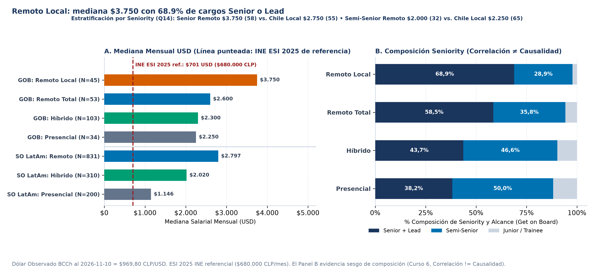
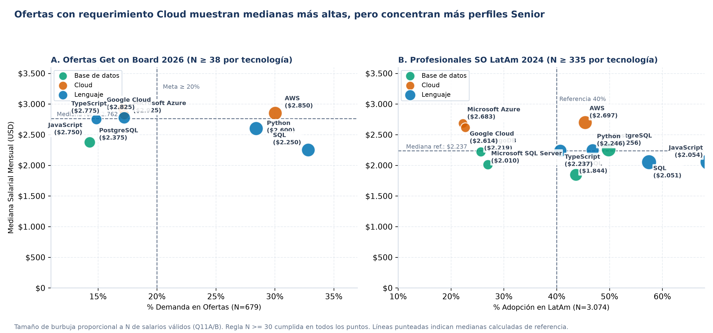

# Mercado Laboral y Salarios en Tecnología en Chile y Latinoamérica (2024–2026)

*Caso de estudio con cliente y partes interesadas simulados (ejercicio académico)*

🌐 **Sitio Web Oficial (GitHub Pages):** [https://jmryanez.github.io/mercado-tech-chile-latam-2026/](https://jmryanez.github.io/mercado-tech-chile-latam-2026/)  
📁 **Repositorio en GitHub:** [https://github.com/jmryanez/mercado-tech-chile-latam-2026](https://github.com/jmryanez/mercado-tech-chile-latam-2026)  
👤 **Autor:** Manuel Yáñez Orellana • **Rótulo profesional:** Analista de Datos  
🎓 **Credencial:** Certificado Profesional de Análisis de Datos de Google (Google Data Analytics Professional Certificate), Google / Coursera, noviembre 2026 • [https://www.credly.com/users/manuel-yanez](https://www.credly.com/users/manuel-yanez)  
🏢 **Patrocinadores simulados:** Consultora de Recursos Humanos Tech & Academia de Formación Digital (Chile)  
📊 **Estado de entregables externos:**  
- Tablero en Tableau Public: pendiente de publicación (datos preparados en Datos_Consolidados_Tableau_Public.xlsx)  
- Cuaderno y dataset en Kaggle: pendientes de publicación  

---

## Síntesis Ejecutiva

Este proyecto investiga qué tecnologías concentran la demanda laboral vigente aplicable a Chile (**Get on Board API v0**, corte 2026-11-10 GMT-3, N = 679 ofertas / N = 235 salarios válidos) frente a la adopción técnica declarada en Chile y Latinoamérica (**Stack Overflow Developer Survey 2024**, 19 países, N = 3074 encuestados / N = 1341 salarios válidos; Chile N = 133 / N = 46 salarios), contextualizadas contra la serie internacional **Data Science Salaries 2020–2024** (N = 6599 registros en total; N = 5305 residentes en EE.UU.) y la línea base nacional chilena **INE ESI 2025** ($680.000 CLP/mes mediana = $701 USD al Dólar Observado BCCh de $969,80 CLP/USD al 2026-11-10; media $962.945 CLP = $992,93).

Las 4 poblaciones se analizan **de forma estrictamente separada** (sin promediar ni fusionar registros entre encuestas y bolsas de empleo) y bajo control de tamaño muestral **N >= 30** (**Curso 4, Módulo 1**).

---

## Conclusiones Estratégicas del Negocio (Fase 6 • Actuar)

### 1. Demanda vs. Adopción Tecnológica (P1)
3 tecnologías superan el 20% de las ofertas en Get on Board: SQL (32,84%, N=223), AWS (30,04%, N=204) y Python (28,42%, N=193). En plataformas Cloud, solo AWS supera el umbral del 20%, mientras que Google Cloud (17,23%, N=117) y Microsoft Azure (17,08%, N=116) se sitúan por debajo del umbral estratégico. La diferencia entre la demanda de Azure (17,08%) y su adopción en Chile (15,04%, ±6,1 pp) está dentro del margen de error muestral.


### 2. Progresión Salarial y Bandas de Seniority (P2)
En Chile Local (Get on Board 2026), la mediana salarial es $2.250 USD en Semi-Senior (N=65, p25 $2.000, p75 $2.500) y $2.750 USD en Senior (N=55, p25 $2.150, p75 $3.675), representando un salto de 22,2% en mediana. Si se considera el conjunto total de Get on Board (Chile + remotas sin país declarado), la mediana Semi-Senior es $2.250 (N=97) y Senior $3.200 (N=113), con un salto de 42,2%. En Stack Overflow Chile agregado (N=46), la mediana es $3.064 USD (~$2.971.031 CLP).


### 3. Modalidad Laboral, Alcance y Comparación INE (P3)
La composición por seniority explica parte de la diferencia, no toda: entre cargos Senior, las ofertas remotas sin país declarado tienen mediana $3.750 frente a $2.750 en Chile Local (diferencia concluyente: +$1.000 USD, IC 95% bootstrap [$500, $1.550]); entre Semi-Senior la remota es menor ($2.000 vs $2.250, diferencia no concluyente: $-250 USD, IC 95% [$-575, $625]). Modalidad y alcance no se pueden separar con estos datos, y no se sabe si las ofertas remotas admiten residentes en Chile. Frente a la mediana nacional del INE ESI 2025 ($680.000 CLP / $701 USD), los cargos en Chile Local ($2.250 USD mediana) representan 3,21x la mediana del INE (220,9%).



### 4. Posicionamiento Regional y Serie Temporal (P4)
En Latinoamérica (Stack Overflow 2024, N ≥ 30), Uruguay registra la mayor mediana muestral ($6.416 USD, N=36). Chile ($3.064 USD, N=46) se sitúa en un grupo estadísticamente no diferenciable frente a Argentina ($2.958 USD, N=124), México ($2.633 USD, N=164) y Colombia ($2.500 USD, N=83) (todos los intervalos de confianza bootstrap del 95% de las diferencias con Chile incluyen el 0). Brasil registra $2.020 USD (N=673) y Venezuela $1.000 USD (N=33). En Data Science Salaries (residentes en EE.UU.), la mediana pasó de $9.917 USD en 2020 (N=28 < 30) a $12.500 USD en 2023 (N=3854) y $11.673 USD en 2024 (N=506).


### 5. Matriz Volumen vs. Compensación y Efecto Cloud (Q11)
Al cruzar volumen de demanda con salarios en Senior de Get on Board, las vacantes que solicitan plataformas Cloud presentan una mediana de $3.750 USD (N=56) frente a $3.000 USD (N=57) en vacantes sin Cloud (diferencia observada de +$750 USD). No obstante, los intervalos de confianza bootstrap del 95% incluyen el 0, por lo que la diferencia no resulta concluyente al controlar por seniority.



---

## Tabla de Recomendaciones Estratégicas (Fase 6 • Actuar)

A partir de los hallazgos con representatividad estadística, se establece la siguiente matriz de implementación Qué / Quién / Cuándo / KPI:

| # | Qué hay que hacer (Acción concreta) | Quién debería hacerlo | Cuándo (Plazo) | Indicador Clave de Rendimiento (KPI) |
|---|---|---|---|---|
| **1** | Alinear currículo formativo a las 3 tecnologías líderes (SQL, AWS, Python) con electivos en cloud computing. | Academia de formación digital | Trimestre 1 (Q1) | Porcentaje de cobertura de tecnologías top en sílabos (meta: ≥ 80% sobre las 3 tecnologías ≥ 20%). |
| **2** | Calibrar bandas salariales diferenciando explícitamente entre vacantes de Chile Local y Remoto sin país declarado. | Consultora de RRHH tech | Trimestre 1 (Q1) | Tasa de ofertas con salario publicado clasificadas por alcance local vs remoto (meta: 100%). |
| **3** | Diseñar rutas de transición y nivelación técnica de Semi-Senior a Senior con foco en diseño de sistemas y arquitectura cloud. | Academia y Consultora en conjunto | Trimestre 2 (Q2) | Brecha porcentual observada entre tramos Semi-Senior y Senior (22,2% en Chile Local). |

---

## Estructura del Repositorio

```text
├── 01_Fase_Preguntar_Ask/ (2 elementos)
│   ├── 01_Alcance_del_Trabajo_SOW.docx (40.6 KB)
│   └── 01_Declaracion_Tarea_Empresarial.docx (41.6 KB)
├── 02_Fase_Preparar_Prepare/ (2 elementos)
│   ├── 02_Descripcion_Fuentes_y_ROCCC.docx (41.5 KB)
│   └── datos_crudos_raw/ (4 elementos)
│       ├── DataScienceSalaries_2020_2024_20261110_v01_raw.csv (671.1 KB)
│       ├── GetOnBoard_OfertasTech_2026_20261110_v01_raw.json (4430.8 KB)
│       ├── INE_ESI_2025_ReferenciaNacional_20261110_v01_raw.csv (0.5 KB)
│       └── StackOverflow_DeveloperSurvey_2024_20261111_v01_raw.csv.gz (16455.0 KB)
├── 03_Fase_Procesar_Process/ (3 elementos)
│   ├── 03_Documentacion_Limpieza_y_Changelog.docx (44.2 KB)
│   ├── datos_limpios_processed/ (7 elementos)
│   │   ├── DataScienceSalaries_2020_2024_20261111_v01_clean.csv (954.3 KB)
│   │   ├── GetOnBoard_Habilidades_2026_20261111_v01_clean.csv (119.4 KB)
│   │   ├── GetOnBoard_Vacantes_2026_20261111_v01_clean.csv (148.1 KB)
│   │   ├── INE_ESI_2025_ReferenciaNacional_20261111_v01_clean.csv (0.6 KB)
│   │   ├── Matriz_TLC_19_Paises_LatAm.csv (2.1 KB)
│   │   ├── StackOverflow_LatAm_2024_20261111_v01_clean.csv (594.7 KB)
│   │   └── StackOverflow_Tecnologias_2024_20261111_v01_clean.csv (1496.5 KB)
│   └── scripts/ (2 elementos)
│       ├── 03_limpieza_y_validacion.py (31.3 KB)
│       └── resumen_validacion_fase3.json (4.5 KB)
├── 04_Fase_Analizar_Analyze/ (4 elementos)
│   ├── 04_Resumen_Analisis_SQL_y_Python.docx (41.1 KB)
│   ├── resumenes/ (37 elementos)
│   │   ├── cifras_oficiales.json (21.7 KB)
│   │   ├── resumen_fase4_completo.json (76.1 KB)
│   │   ├── resumen_ic_diferencias.csv (0.6 KB)
│   │   ├── resumen_p1_tecnologias_gob_vs_so.csv (3.9 KB)
│   │   ├── resumen_p2_bandas_chile_local.csv (1.5 KB)
│   │   ├── resumen_p2_bandas_remoto_sin_pais.csv (1.3 KB)
│   │   ├── resumen_p2_salarios_experiencia.csv (1.8 KB)
│   │   ├── resumen_p3_comparacion_ine_chile_local.csv (0.6 KB)
│   │   ├── resumen_p3_salarios_modalidad_vs_ine.csv (2.3 KB)
│   │   ├── resumen_p4_dss_eeuu_anio_tamano.csv (0.6 KB)
│   │   ├── resumen_p4_dss_eeuu_temporal.csv (0.6 KB)
│   │   ├── resumen_p4_tamano_empresa_y_dss_temporal.csv (2.8 KB)
│   │   ├── resumen_paises_so_latam_n30.csv (0.7 KB)
│   │   ├── resumen_q11_tecnologia_vs_salario.csv (2.7 KB)
│   │   ├── resumen_q12_modalidad_composicion_seniority.csv (0.3 KB)
│   │   ├── resumen_q13_gob_categorias.csv (1.3 KB)
│   │   ├── resumen_q14_modalidad_x_seniority.csv (6.2 KB)
│   │   ├── resumen_q15_tecnologia_x_seniority.csv (0.5 KB)
│   │   ├── resumen_sensibilidad_so_full_time.csv (0.4 KB)
│   │   ├── resumen_sensibilidades.csv (2.3 KB)
│   │   ├── sql_q01_control_integridad_left_join.csv (0.2 KB)
│   │   ├── sql_q02_tecnologias_cruce_demanda_vs_adopcion.csv (3.2 KB)
│   │   ├── sql_q03_gob_tecnologias_meta_20pct_having.csv (0.1 KB)
│   │   ├── sql_q04_gob_salarios_por_seniority.csv (0.5 KB)
│   │   ├── sql_q05_so_latam_salarios_por_experiencia.csv (0.3 KB)
│   │   ├── sql_q06_gob_salarios_por_modalidad_y_alcance.csv (0.3 KB)
│   │   ├── sql_q07_so_latam_salarios_por_modalidad.csv (0.2 KB)
│   │   ├── sql_q08_so_latam_salarios_por_tamano_empresa.csv (0.3 KB)
│   │   ├── sql_q09_dss_evolucion_2020_2024_y_tamano.csv (0.7 KB)
│   │   ├── sql_q10_so_chile_vs_resto_latam.csv (0.2 KB)
│   │   ├── sql_q11a_gob_tecnologia_vs_salario.csv (0.4 KB)
│   │   ├── sql_q11b_so_latam_tecnologia_vs_salario.csv (3.1 KB)
│   │   ├── sql_q12_gob_modalidad_composicion_seniority.csv (0.3 KB)
│   │   ├── sql_q13_gob_salarios_por_categoria.csv (0.7 KB)
│   │   ├── sql_q14_gob_salarios_estratificados_seniority_alcance.csv (0.4 KB)
│   │   ├── sql_q14b_gob_salarios_estratificados_seniority_modalidad.csv (0.6 KB)
│   │   └── sql_q15_gob_tecnologia_estratificada_seniority.csv (0.5 KB)
│   ├── scripts/ (1 elementos)
│   │   └── 04_analisis_estadistico_python.py (62.5 KB)
│   └── sql/ (1 elementos)
│       └── 04_consultas_analisis.sql (23.4 KB)
├── 05_Fase_Compartir_Share/ (5 elementos)
│   ├── 05_Diseno_Visual_Tableau_y_Presentacion.docx (48.3 KB)
│   ├── 05_Presentacion_Ejecutiva_30min.pdf (2747.0 KB)
│   ├── Datos_Consolidados_Tableau_Public.xlsx (26.4 KB)
│   ├── scripts/ (1 elementos)
│   │   └── 05_generar_visualizaciones_y_deck.py (59.9 KB)
│   └── visualizaciones/ (7 elementos)
│       ├── 01_demanda_vs_adopcion_top5_p1.png (412.6 KB)
│       ├── 02_matriz_volumen_vs_salario_q11.png (465.2 KB)
│       ├── 03_mapa_calor_tecnologias_mercado.png (482.0 KB)
│       ├── 04_bandas_salariales_experiencia_p2.png (298.0 KB)
│       ├── 05_modalidades_vs_ine_y_causalidad_p3_q12.png (331.2 KB)
│       ├── 06_paises_latam_y_tamano_empresa_p4.png (354.7 KB)
│       └── 07_evolucion_dss_2020_2024_p4.png (300.1 KB)
├── 06_Fase_Actuar_Act/ (2 elementos)
│   ├── 06_Plan_de_Accion_y_Conclusiones_Finales.docx (43.6 KB)
│   └── kaggle_notebook_portafolio.ipynb (224.7 KB)
├── apple-touch-icon.png (41.3 KB)
├── CHANGELOG.md (16.8 KB)
├── DATA_LICENSES.md (1.8 KB)
├── descargas/ (11 elementos)
│   ├── 05_Presentacion_Ejecutiva_30min.pdf (2747.0 KB)
│   ├── Bandas_Salariales_y_Saltos_Seniority.csv (2.2 KB)
│   ├── dataset-metadata.json (2.1 KB)
│   ├── Datos_Consolidados_Tableau_Public.xlsx (26.4 KB)
│   ├── Datos_Limpios_Completos_Kaggle.zip (309.7 KB)
│   ├── Explorador_Datasets_Consolidados.json (305.8 KB)
│   ├── GetOnBoard_Vacantes_Auditadas_679.csv (108.0 KB)
│   ├── kaggle_notebook_portafolio.ipynb (224.7 KB)
│   ├── Matriz_TLC_19_Paises_LatAm.csv (2.1 KB)
│   ├── Matriz_Validacion_Integridad_Calidad.csv (3.2 KB)
│   └── StackOverflow_LatAm_19_Paises_2024.csv (594.7 KB)
├── DIARIO_DE_DATOS_BITACORA.docx (40.8 KB)
├── explorador_datasets.json (305.8 KB)
├── favicon-32x32.png (2.6 KB)
├── favicon-512x512.png (209.0 KB)
├── favicon.ico (0.9 KB)
├── favicon.png (576.2 KB)
├── index.html (177.5 KB)
├── LICENSE (1.1 KB)
├── og_image_1200x630.png (65.3 KB)
├── README.md
├── requirements.txt (0.2 KB)
└── scripts/ (8 elementos)
    ├── actualizar_documentos_docx.py (3.4 KB)
    ├── actualizar_index_html.py (2.2 KB)
    ├── actualizar_readme.py (4.3 KB)
    ├── ejecutar_todo.py (4.6 KB)
    ├── generar_descargas.py (21.4 KB)
    ├── generar_y_ejecutar_cuaderno.py (13.6 KB)
    ├── plantillas/ (10 elementos)
    │   ├── 01_Fase_Preguntar_Ask/ (2 elementos)
    │   │   ├── 01_Alcance_del_Trabajo_SOW.docx (40.6 KB)
    │   │   └── 01_Declaracion_Tarea_Empresarial.docx (41.6 KB)
    │   ├── 02_Fase_Preparar_Prepare/ (1 elementos)
    │   │   └── 02_Descripcion_Fuentes_y_ROCCC.docx (41.5 KB)
    │   ├── 03_Fase_Procesar_Process/ (1 elementos)
    │   │   └── 03_Documentacion_Limpieza_y_Changelog.docx (44.3 KB)
    │   ├── 04_Fase_Analizar_Analyze/ (1 elementos)
    │   │   └── 04_Resumen_Analisis_SQL_y_Python.docx (41.4 KB)
    │   ├── 05_Fase_Compartir_Share/ (1 elementos)
    │   │   └── 05_Diseno_Visual_Tableau_y_Presentacion.docx (48.6 KB)
    │   ├── 06_Fase_Actuar_Act/ (1 elementos)
    │   │   └── 06_Plan_de_Accion_y_Conclusiones_Finales.docx (43.8 KB)
    │   ├── cuaderno_plantillas.json (22.2 KB)
    │   ├── DIARIO_DE_DATOS_BITACORA.docx (40.8 KB)
    │   ├── index.html (182.5 KB)
    │   └── README.md (9.4 KB)
    └── validar_consistencia.py (9.4 KB)
```

---

## Cómo Reproducir este Proyecto

### Requisitos Previos
- Python 3.10 o superior
- Git

### Instrucciones Paso a Paso
```bash
# 1. Clonar el repositorio
git clone https://github.com/jmryanez/mercado-tech-chile-latam-2026.git
cd mercado-tech-chile-latam-2026

# 2. Crear y activar entorno virtual
python3 -m venv venv
source venv/bin/activate  # En Windows: venv\Scripts\activate

# 3. Instalar dependencias
pip install -r requirements.txt

# 4. Ejecutar el orquestador maestro reproducible
python3 scripts/ejecutar_todo.py
```
