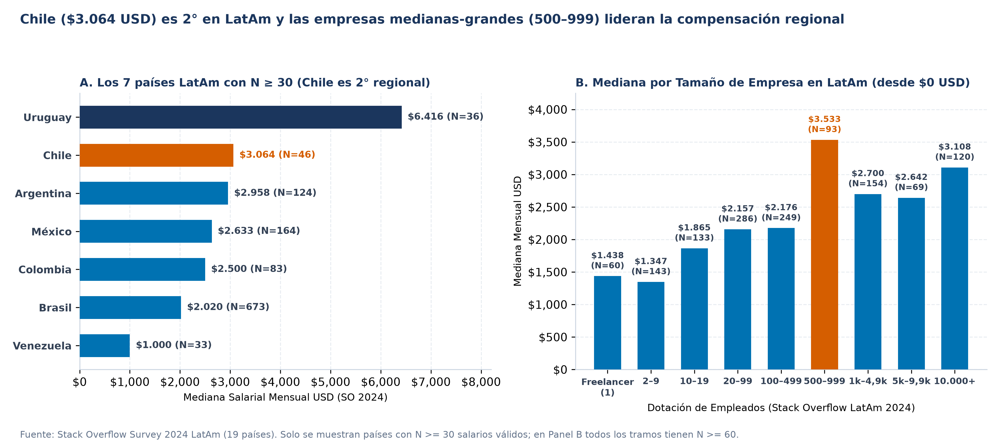
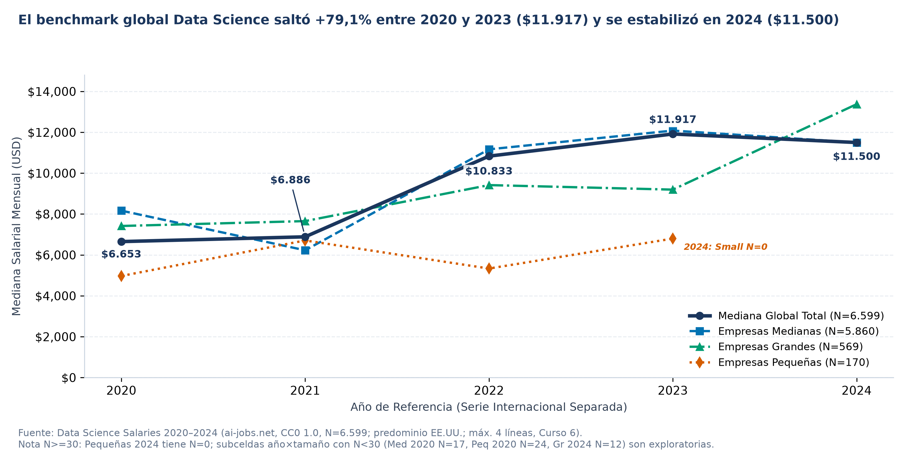

# Portafolio Google Data Analytics — Caso Práctico 3 (Pista B)

**Estudio:** *Mercado Laboral y Salarios en Tecnología en Chile y Latinoamérica (2024–2026)*  
**Autor:** Manuel Yáñez Orellana • **Patrocinador simulado:** Consultora RRHH Tech & Academia Digital (Chile)  
**Metodología:** 6 fases oficiales del **Certificado Profesional de Análisis de Datos de Google** (*Preguntar, Preparar, Procesar, Analizar, Compartir y Actuar*) — Cursos 1 a 9.

---

## Síntesis Ejecutiva

Este proyecto investiga con trazabilidad reproducible qué tecnologías concentran la demanda laboral vigente aplicable a Chile (**Get on Board API v0**, corte `2026-11-10 GMT-3`, `N = 679` ofertas / `N = 235` salarios válidos) frente a la adopción profesional real en Chile y Latinoamérica (**Stack Overflow Survey 2024**, `19` países, `N = 3.074` / `1.341` salarios válidos; Chile `N = 133` / `46` salarios), contextualizadas contra la serie internacional **Data Science Salaries 2020–2024** (`N = 6.599`, `CC0 1.0`) y la línea base nacional chilena **INE ESI 2025** (`$680.000 CLP` netos/mes = `$701,18 USD` al Dólar Observado BCCh de `$969,80 CLP/USD` al `2026-11-10`).

Las cuatro poblaciones se analizan **de forma estrictamente separada** (sin promediar ni sumar registros entre encuestas y bolsas de empleo) y bajo control muestral **`N >= 30`** (**Curso 4, Módulo 1**).

---

## Glosario Metodológico: Qué es `N`, Regla `N >= 30` y sus Derivadas (Curso 4, Módulo 1)

Conforme a la lectura oficial *Calcular el tamaño de la muestra* (**Curso 4, Módulo 1**):

- **`N`**: Conteo exacto de observaciones independientes válidas (ofertas únicas, encuestados o salarios válidos) dentro de un universo o segmento.
- **Por qué `N >= 30`**: Según el **Teorema del Límite Central (CLT)**, `30` es el tamaño mínimo de muestra a partir del cual los resultados comienzan a representar de manera estable a la población bajo un **nivel de confianza del 95%**, reduciendo el margen de error y el riesgo de hallazgos por azar (**significación estadística**).
- **Derivadas utilizadas en el proyecto**:
  1. **`N` universo total vs. `N` salarios válidos**: Separación de denominadores (`679` ofertas vs. `235` salarios válidos en Get on Board; `3.074` vs. `1.341` en Stack Overflow LatAm; `133` vs. `46` en Chile).
  2. **`N >= 30` (`cumple_n30 = True`)**: Subgrupos habilitados para inferencias descriptivas, bandas `p25–p75` y recomendaciones operativas.
  3. **`N < 30` (`exploratorio` / `cumple_n30 = False`)**: Submuestras reportadas por transparencia sin fijar reglas automáticas (`GOB Junior N=17`, `Lead N=7`, `Trainee N=1`, `ML & AI N=21`, `SysAdmin/DevOps/QA N=24`, `Product N=20`, `12` países de LatAm y subceldas año×tamaño DSS `Med 2020 N=17`, `Peq 2020 N=24`, `Gr 2024 N=12`).
  4. **`N = 0`**: Ausencia total de registros válidos en esa intersección (`Empresas Pequeñas 2024` en DSS).
  5. **Cotas observadas (`N >= 38`, `N >= 335`, `N >= 34`, `N >= 60`, `N >= 75`)**: Indican el `N` real más bajo presente dentro de una gráfica o tabla específica después de filtrar por `N >= 30`.

---

## Hallazgos Clave y Visualizaciones (`300 DPI`)

### 1. Top 5 Demanda Tecnológica (`>= 20%`) y Matriz Volumen vs. Compensación (`P1` y `Q11`)
- Exactamente `5` tecnologías superan el `20%` de aparición en Get on Board (`N=679`): **SQL (`32,84%`)**, **AWS (`30,04%`)**, **Python (`28,42%`)**, **JavaScript (`27,39%`)** y **Microsoft Azure (`20,77%`)**, con brecha positiva formativa de `Azure` frente a adopción en Chile (`15,04%`).
- `SQL` concentra mayor volumen (`32,84%` GOB; `57,48%` LatAm) marcando el piso salarial (`$2.250` GOB / `$2.051,33` SO LatAm), mientras **Cloud (`AWS`, `Google Cloud`, `Azure`)** eleva la mediana entre **`+23,3%` y `+31,5%`**.


### 2. Experiencia (`p25–p75`), Paradoja Remota (`Correlación != Causalidad`) y Contexto Regional/Global
- **Experiencia (`P2`)**: En Get on Board, **Semi-Senior** (`$2.250 USD`, `N=97`) -> **Senior** (`$3.200 USD`, `N=113`, **`+42,2%`**). En Stack Overflow LatAm (`N >= 89` por tramo), crece de forma continua y ascendente **`+566,6%`** desde `<2 años` (`$559,50`) a `10+ años` (`$3.729,75`).
- **Modalidad y Causalidad (`P3` y `Q12`)**: `Remoto Local` alcanza `$3.750 USD/mes` (`5,35x INE`), pero **el `100%` (`45/45`) pertenece a alcance Remoto Global/LatAm y `68,9%` exige Senior o Lead** (vs. `38,2% Senior` y `0% Lead` en Presencial).
- **Geografía y Tamaño (`P4`)**: **Chile es 2° en LatAm** (`$3.063,54 USD/mes`, `~$2.971.022 CLP`, `N=46`) detrás de Uruguay (`$6.416,42`, `N=36`) entre los `7` países con `N >= 30`. En LatAm, `500–999` empleados alcanza `$3.532,67 USD` (`N=93`). La serie global **DSS (`N=6.599`)** saltó `+79,1%` entre `2020` (`$6.652,75`) y `2023` (`$11.916,67`), estabilizándose en `2024` (`$11.500,00`, `-3,5%`).





---

## Recomendaciones Prioritarias (`Qué / Quién / Cuándo`)

| # | Acción Prioritaria | Responsable | Plazo |
| :---: | :--- | :--- | :---: |
| **1** | Rediseñar currículo en 2 niveles: **Núcleo Empleabilidad** (`SQL + Python + JS + PostgreSQL`) + **Track Cloud** (`AWS + Microsoft Azure + TypeScript`). | Dirección Académica (Academia Digital) | `30–60 días` |
| **2** | Calibrar bandas con cuartiles `p25–p75` (`Semi-Senior $1.850–$2.600`, `Senior $2.300–$4.000`, `Remoto Global $3.275`) distinguiendo causalidad de composición. | Gerencia de Consultoría RRHH Tech | Inmediato (`0–30 días`) |
| **3** | Exigir sueldo explícito (`bruto/líquido + moneda >= $500 USD`) en nuevas vacantes (hoy `34,6%` válido) y levantar `N >= 30` en segmentos exploratorios. | RRHH Tech + Equipo Analítico | Trimestral (`60–90 días`) |

---

## Estructura del Repositorio (Fases 1 a 6)

```text
├── 01_Fase_Preguntar_Ask/
│   ├── 01_Alcance_del_Trabajo_SOW.docx
│   └── 01_Declaracion_Tarea_Empresarial.docx
├── 02_Fase_Preparar_Prepare/
│   ├── 02_Descripcion_Fuentes_y_ROCCC.docx
│   └── datos_crudos_raw/                 # Inmutables (21,05 MiB, 4 fuentes, 0% PII)
├── 03_Fase_Procesar_Process/
│   ├── 03_Documentacion_Limpieza_y_Changelog.docx
│   ├── datos_limpios_processed/          # 6 CSVs limpios (3,20 MiB totales)
│   └── scripts/03_limpieza_y_validacion.py
├── 04_Fase_Analizar_Analyze/
│   ├── 04_Resumen_Analisis_SQL_y_Python.docx
│   ├── resumenes/                        # 22 CSVs + resumen_fase4_completo.json
│   ├── scripts/04_analisis_estadistico_python.py
│   └── sql/04_consultas_analisis.sql     # 14 consultas Q01–Q13 en SQLite
├── 05_Fase_Compartir_Share/
│   ├── 05_Diseno_Visual_Tableau_y_Presentacion.docx
│   ├── 05_Presentacion_Ejecutiva_30min.pdf
│   ├── Datos_Consolidados_Tableau_Public.xlsx
│   ├── scripts/05_generar_visualizaciones_y_deck.py
│   └── visualizaciones/                  # 7 gráficos PNG a 300 DPI
├── 06_Fase_Actuar_Act/
│   ├── 06_Plan_de_Accion_y_Conclusiones_Finales.docx
│   └── kaggle_notebook_portafolio.ipynb  # Listo para Kaggle Public
├── CHANGELOG.md
├── DIARIO_DE_DATOS_BITACORA.docx
└── README.md
```

---

## Reproducibilidad Técnica y Publicación

```bash
# 1. Limpieza y validación (Fase 3)
python3 03_Fase_Procesar_Process/scripts/03_limpieza_y_validacion.py

# 2. Análisis SQLite Q01–Q13 + Python descriptivo (Fase 4)
python3 04_Fase_Analizar_Analyze/scripts/04_analisis_estadistico_python.py

# 3. Visualizaciones PNG, paquete Tableau Public y Deck PDF 30 min (Fase 5)
python3 05_Fase_Compartir_Share/scripts/05_generar_visualizaciones_y_deck.py
```

- **Tableau Public (tablero interactivo):** *Listo para vincular tras carga de `Datos_Consolidados_Tableau_Public.xlsx` (`9` hojas independientes).*
- **Kaggle Notebook:** [`06_Fase_Actuar_Act/kaggle_notebook_portafolio.ipynb`](06_Fase_Actuar_Act/kaggle_notebook_portafolio.ipynb) *(listo para importar junto a `03_Fase_Procesar_Process/datos_limpios_processed/`)*.

---

## Fuentes y Licencias

- **Get on Board** (API pública v0, corte `2026-11-10 GMT-3`)
- **Stack Overflow Annual Developer Survey 2024** (Open Data)
- **Data Science Salaries 2020–2024** (`ai-jobs.net`, licencia `CC0 1.0 Universal`)
- **Instituto Nacional de Estadísticas de Chile (INE)** — *Encuesta Suplementaria de Ingresos (ESI) 2025*
- **Banco Central de Chile (BCCh)** — Dólar Observado al `2026-11-10` (`$969,80 CLP/USD`)
